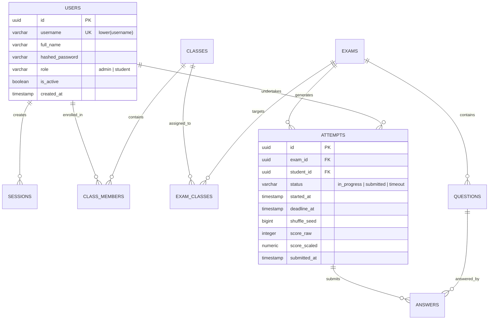
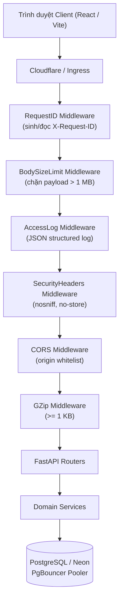
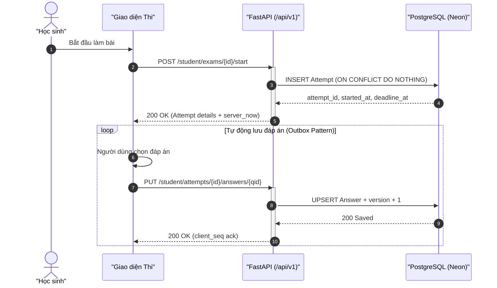

# Mermaid Diagram & ERD Modeling Skill

Use this skill when designing, visualizing, documenting, or verifying system architectures, database schemas (ERD), workflows, and protocol sequences using Mermaid.

---

## 1. Overview & MCP Integration

This skill connects Antigravity with the **Mermaid Chart MCP Server** (`https://mcp.mermaid.ai/mcp`) and local validation toolchains to deliver:
- **Relational Database ERD Modeling:** Accurate entity-relationship diagrams for PostgreSQL, SQLAlchemy models, and Alembic migrations.
- **Architectural Flowcharts:** System boundaries, API gateway pipelines, middleware chains, and deployment topology.
- **Sequence & State Workflows:** User journey transactions, monotonic exam clock synchronization, WebSocket/REST lifecycles.
- **Automated Syntax Validation:** Pre-flight checks preventing syntax errors, unescaped labels, and malformed cardinalities.

---

## 2. MCP Server Configuration

The Mermaid MCP server is registered in `.agents/mcp_config.json` and `~/.gemini/config/mcp_config.json`:

```json
{
  "mcpServers": {
    "mermaid": {
      "url": "https://mcp.mermaid.ai/mcp"
    }
  }
}
```

### Available MCP Tools
- **`validate_and_render_mermaid_diagram` / `display_mermaid`**: Validates syntax and renders an interactive diagram widget or SVG/PNG preview.
- **`list_mermaid_chart_diagrams` / `list_personal_diagrams`**: Lists saved diagrams from your connected Mermaid Chart account.

---

## 3. Strict Syntax Standards by Diagram Type

### A. Entity-Relationship Diagrams (`erDiagram`) — Primary for Task 2.2
When modeling database schemas for SQLAlchemy and PostgreSQL:

1. **Header:** Always start with `erDiagram`.
2. **Cardinality Operators:**
   - Exactly one: `||`
   - Zero or one: `|o` or `o|`
   - One or more: `}|` or `|{`
   - Zero or more: `}o` or `o{`
   - Standard relational edges:
     - `USER ||--o{ ATTEMPT : "makes"` (One user has zero or many attempts)
     - `EXAM ||--|{ QUESTION : "contains"` (One exam has one or more questions)
     - `ATTEMPT ||--o{ ANSWER : "records"` (One attempt has zero or many answers)
     - `CLASS ||--o{ CLASS_MEMBER : "enrolls"`
     - `USER ||--o{ CLASS_MEMBER : "belongs_to"`
3. **Entity Syntax:**
   - Use uppercase singular or snake_case for entity names (`USERS`, `EXAMS`, `ATTEMPTS`).
   - Define fields with `<type> <attribute_name> [<key_type>] ["<comment>"]`.
   - Key types: `PK` (Primary Key), `FK` (Foreign Key), `UK` (Unique Constraint).
   - Standard types: `uuid`, `varchar(n)`, `text`, `integer`, `bigint`, `boolean`, `timestamp`, `jsonb`, `numeric`.



---

### B. Architecture & Middleware Flowcharts (`flowchart TD` / `flowchart LR`)

1. **Orientation:** `flowchart TD` (Top-to-Down) for vertical request chains; `flowchart LR` (Left-to-Right) for multi-tier pipelines.
2. **Label Quoting:** Always wrap text containing brackets, parentheses, or spaces in double quotes:
   - ✅ Correct: `req["Request (X-Request-ID)"]`
   - ❌ Wrong: `req[Request (X-Request-ID)]` (triggers parse error).
3. **Subgraphs:** Group components logically (e.g. `subgraph MiddlewareStack`, `subgraph DatabaseLayer`).
4. **Styling:** Use standard CSS classes or semantic styles matching the design tokens (`stroke`, `fill`).



---

### C. Sequence Diagrams (`sequenceDiagram`)

1. **Participants:** Define participants explicitly at the top with `autonumber` and clear aliases:
   `autonumber`
   `actor Student as "Học sinh"`
   `participant UI as "React SPA"`
   `participant API as "FastAPI Backend"`
   `participant DB as "PostgreSQL"`
2. **Message Arrows:**
   - Synchronous call: `->>`
   - Synchronous return / response: `-->>`
   - Asynchronous / fire-and-forget: `-)`
3. **Notes and Activations:**
   - Use `activate` and `deactivate` to show processing lifetime.
   - Use `Note over ...` for critical constraints (e.g., Monotonic clock, optimistic locking).



---

## 4. Quality Checklist & Error Prevention

Before writing or embedding any Mermaid diagram into documentation or artifacts:
1. **0 Unquoted Special Characters:** Check all labels for `()`, `[]`, `{}`, `<>`, `:`, and wrap them in `"..."`.
2. **0 HTML/Markdown inside Labels:** Do not use `<b>`, `<i>`, `<br>` (use `\n` for linebreaks).
3. **Accurate Relationship Direction:** Always verify cardinality symbols (`||--o{`, `||--||`).
4. **Semantic Consistency:** Entity and column names in the ERD must match 100% with SQLAlchemy models (`backend/app/models/`) and spec definitions.
5. **Local Validation:** Use `.agents/skills/mermaid/scripts/validate_mermaid.py` to verify diagrams before committing.
