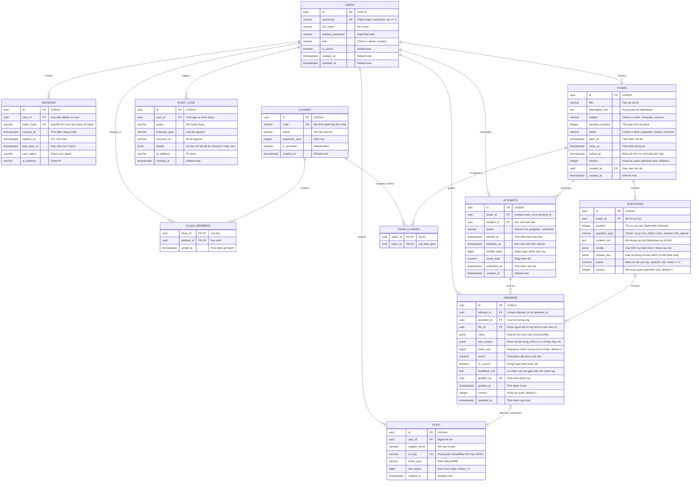

# THIẾT KẾ MÔ HÌNH DỮ LIỆU QUAN HỆ (ERD) — HỆ THỐNG QUIZ TOÁN – TIN

> **Tài liệu tham chiếu:** `ke-hoach-trien-khai-quiz.md` (Mục 2.2, 4.1 & 7.0), `quiz-toan-tin-spec.md`  
> **Công cụ:** Mermaid v11 (Mermaid Chart MCP)  
> **Cơ sở dữ liệu đích:** PostgreSQL 16 (Neon Serverless PgBouncer)  
> **ORM & Migration:** SQLAlchemy 2.0 + Alembic

---

## 1. Sơ đồ Thực thể Quan hệ Tổng thể (Mermaid ERD)



---

## 2. Đặc Tả Chi Tiết 4 Dạng Câu Hỏi & Cấu Trúc JSON

### 2.1. Dạng 1: Câu hỏi trắc nghiệm (MCQ)
- **Phương án:** Cố định 4 phương án lựa chọn A, B, C, D (hoặc mã nội bộ $o_1, o_2, o_3, o_4$ để xáo trộn không làm lệch nhãn).
- **Cấu hình `QUESTIONS.config`:**
  ```json
  {
    "options": [
      {"id": "o1", "content_md": "Phương án A", "label": "A"},
      {"id": "o2", "content_md": "Phương án B", "label": "B"},
      {"id": "o3", "content_md": "Phương án C", "label": "C"},
      {"id": "o4", "content_md": "Phương án D", "label": "D"}
    ],
    "shuffle_options": true
  }
  ```
- **Đáp án đúng `QUESTIONS.answer_key`:**
  ```json
  {
    "correct": "o2"
  }
  ```
- **Bài nộp học sinh `ANSWERS.value`:**
  ```json
  {
    "selected": "o2"
  }
  ```

---

### 2.2. Dạng 2: Câu hỏi Đúng / Sai (True / False)

#### Thể dạng 2A: Một câu hỏi gồm 4 ý nhỏ $a, b, c, d$
Mỗi ý có 2 lựa chọn: Đúng / Sai. Giáo viên lựa chọn 1 trong 2 cơ chế tính điểm (`scoring_mode`):
1. **Kiểu 1 — Chia điểm theo từng ý (`scoring_mode = "per_item"`):**
   - Giáo viên tùy biến điểm cho từng ý nhỏ $a, b, c, d$ (ví dụ: $a=0.25$, $b=0.5$, $c=0.25$, $d=0.5$).
2. **Kiểu 2 — Tính điểm theo số lượng ý đúng (`scoring_mode = "step_threshold"` - Chuẩn đề thi TN THPT mới):**
   - Thang điểm lũy tiến theo số ý đúng do giáo viên tự customize (ví dụ: đúng 1/4 ý được 0.1đ, đúng 2/4 ý được 0.25đ, đúng 3/4 ý được 0.5đ, đúng 4/4 ý được 1.0đ).

- **Cấu hình `QUESTIONS.config`:**
  ```json
  {
    "format": "group_4",
    "items": [
      {"id": "a", "content_md": "Mệnh đề a"},
      {"id": "b", "content_md": "Mệnh đề b"},
      {"id": "c", "content_md": "Mệnh đề c"},
      {"id": "d", "content_md": "Mệnh đề d"}
    ],
    "scoring_mode": "step_threshold",
    "step_scores": {
      "1": 0.10,
      "2": 0.25,
      "3": 0.50,
      "4": 1.00
    },
    "item_points": {
      "a": 0.25,
      "b": 0.50,
      "c": 0.25,
      "d": 0.50
    }
  }
  ```
- **Đáp án đúng `QUESTIONS.answer_key`:**
  ```json
  {
    "answers": {
      "a": true,
      "b": false,
      "c": true,
      "d": true
    }
  }
  ```
- **Bài nộp học sinh `ANSWERS.value`:**
  ```json
  {
    "answers": {
      "a": true,
      "b": false,
      "c": false,
      "d": true
    }
  }
  ```
- **Điểm chi tiết lưu tại `ANSWERS.sub_scores`:**
  ```json
  {
    "correct_count": 3,
    "items": {
      "a": {"student": true, "correct": true, "is_match": true},
      "b": {"student": false, "correct": false, "is_match": true},
      "c": {"student": false, "correct": true, "is_match": false},
      "d": {"student": true, "correct": true, "is_match": true}
    },
    "awarded_score": 0.50
  }
  ```

#### Thể dạng 2B: Một câu hỏi duy nhất với 2 lựa chọn "Đúng" / "Sai"
- **Cấu hình `QUESTIONS.config`:**
  ```json
  {
    "format": "single",
    "options": [
      {"id": "true", "label": "Đúng"},
      {"id": "false", "label": "Sai"}
    ]
  }
  ```
- **Đáp án đúng `QUESTIONS.answer_key`:**
  ```json
  {
    "correct": true
  }
  ```
- **Bài nộp học sinh `ANSWERS.value`:**
  ```json
  {
    "selected": true
  }
  ```

---

### 2.3. Dạng 3: Câu hỏi trả lời ngắn dạng số thập phân (Short Answer Decimal)
- Học sinh nhập số thập phân (hỗ trợ dấu âm, số thực).
- Giáo viên cấu hình dung sai sai số (`tolerance`) và tập các giá trị chấp nhận được.
- **Cấu hình `QUESTIONS.config`:**
  ```json
  {
    "input_type": "decimal",
    "tolerance": 0.01,
    "tolerance_type": "abs",
    "unit": "cm"
  }
  ```
- **Đáp án đúng `QUESTIONS.answer_key`:**
  ```json
  {
    "accepted_values": [3.14, 3.1416],
    "tolerance": 0.01,
    "tolerance_type": "abs"
  }
  ```
- **Bài nộp học sinh `ANSWERS.value`:**
  ```json
  {
    "value": 3.14
  }
  ```

---

### 2.4. Dạng 4: Câu hỏi tự luận nộp tệp bài làm (File Upload Essay)
- Học sinh làm bài trên giấy/máy tính rồi tải tệp lên (mã nguồn `.cpp`, `.py`, tài liệu `.docx`, `.pdf`, ảnh `.png`,...).
- Giáo viên cấu hình danh sách đuôi tệp cho phép (`allowed_extensions`), dung lượng tối đa (`max_file_size_mb`), số lượng tệp tối đa (`max_files`).
- Chấm điểm: Chấm thủ công bởi giáo viên kèm tiêu chí chấm (`rubric`) và lời nhận xét (`feedback_md`).
- **Cấu hình `QUESTIONS.config`:**
  ```json
  {
    "allowed_extensions": ["docx", "pdf", "cpp", "py", "zip"],
    "max_file_size_mb": 10,
    "max_files": 1,
    "rubric_md": "Tiêu chí chấm điểm: Thuật toán đúng (0.5đ), Tối ưu thời gian (0.5đ)"
  }
  ```
- **Đáp án đúng `QUESTIONS.answer_key`:**
  ```json
  {
    "grading": "manual",
    "solution_md": "Mã nguồn tham khảo và lời giải chuẩn của giáo viên",
    "rubric": [
      {"criterion": "Tính đúng đắn", "max_points": 0.5},
      {"criterion": "Độ phức tạp O(N log N)", "max_points": 0.5}
    ]
  }
  ```
- **Bài nộp học sinh `ANSWERS.value`:**
  ```json
  {
    "file_id": "9b1deb4d-3b7d-4bad-9bdd-2b0d7b3dcb6d",
    "file_name": "bai_lam_toan.docx",
    "s3_key": "submissions/2026/exam1/bai_lam_toan.docx",
    "file_size": 204800
  }
  ```
- Khóa ngoại `ANSWERS.file_id` trỏ trực tiếp đến `FILES.id`.
