# THIẾT KẾ MÔ HÌNH DỮ LIỆU QUAN HỆ (ERD) — HỆ THỐNG QUIZ TOÁN – TIN

> **Tài liệu tham chiếu:** `ke-hoach-trien-khai-quiz.md` (Mục 2.2 & 7.0), `quiz-toan-tin-spec.md`  
> **Công cụ:** Mermaid v11 (Mermaid Chart MCP)  
> **Cơ sở dữ liệu đích:** PostgreSQL 16 (Neon Serverless PgBouncer)  
> **ORM & Migration:** SQLAlchemy 2.0 + Alembic

---

## 1. Sơ đồ Thực thể Quan hệ Tổng thể (Mermaid ERD)

```mermaid
erDiagram
    USERS ||--o{ SESSIONS : "creates"
    USERS ||--o{ CLASS_MEMBERS : "belongs_to"
    USERS ||--o{ EXAMS : "authors"
    USERS ||--o{ ATTEMPTS : "undertakes"
    USERS ||--o{ ANSWERS : "grades"
    USERS ||--o{ FILES : "uploads"
    USERS ||--o{ AUDIT_LOGS : "triggers"

    CLASSES ||--o{ CLASS_MEMBERS : "contains"
    CLASSES ||--o{ EXAM_CLASSES : "assigned_exams"

    EXAMS ||--o{ EXAM_CLASSES : "assigned_to"
    EXAMS ||--|{ QUESTIONS : "contains"
    EXAMS ||--o{ ATTEMPTS : "generates"

    ATTEMPTS ||--o{ ANSWERS : "records"
    QUESTIONS ||--o{ ANSWERS : "receives"

    USERS {
        uuid id PK "UUIDv4"
        varchar username UK "Check lower username, len >= 3"
        varchar full_name "Ho va ten"
        varchar hashed_password "Argon2id hash"
        varchar role "Check in admin, student"
        boolean is_active "Default true"
        timestamptz created_at "Default now"
        timestamptz updated_at "Default now"
    }

    SESSIONS {
        uuid id PK "UUIDv4"
        uuid user_id FK "Cascade delete on user"
        varchar token_hash UK "sha256 hex cua raw token 32 bytes"
        timestamptz created_at "Thoi diem dang nhap"
        timestamptz expires_at "TTL 12h truot"
        timestamptz last_seen_at "Cap nhat moi 5 phut"
        varchar user_agent "Client user agent"
        varchar ip_address "Client IP"
    }

    CLASSES {
        uuid id PK "UUIDv4"
        varchar code UK "Ma dinh danh lop duy nhat"
        varchar name "Ten lop hien thi"
        integer academic_year "Nam hoc"
        boolean is_archived "Default false"
        timestamptz created_at "Default now"
    }

    CLASS_MEMBERS {
        uuid class_id PK,FK "Lop hoc"
        uuid student_id PK,FK "Hoc sinh"
        timestamptz joined_at "Thoi diem ghi danh"
    }

    EXAMS {
        uuid id PK "UUIDv4"
        varchar title "Tieu de de thi"
        text description_md "Huong dan thi Markdown"
        varchar subject "Check in math, computer_science"
        integer duration_minutes "Thoi gian lam bai phut"
        varchar status "Check in draft, published, locked, archived"
        timestamptz open_at "Thoi diem mo de"
        timestamptz close_at "Thoi diem dong de"
        timestamptz locked_at "Khoa de khi hoc sinh dau tien nop"
        integer version "Khoa lac quan optimistic lock, default 1"
        uuid created_by FK "Giao vien tao de"
        timestamptz created_at "Default now"
    }

    EXAM_CLASSES {
        uuid exam_id PK,FK "De thi"
        uuid class_id PK,FK "Lop duoc giao"
    }

    QUESTIONS {
        uuid id PK "UUIDv4"
        uuid exam_id FK "De thi so huu"
        integer position "Thu tu cau hoi, Deferrable Deferred"
        varchar question_type "Check in mcq, multi_select, true_false, short_answer, file_upload"
        text content_md "Noi dung cau hoi Markdown va KaTeX"
        jsonb choices "Danh sach lua chon lua chon lua chon"
        jsonb answer_key "Dap an dung chi admin duoc xem"
        numeric points "Diem so, default 1.00, check points >= 0"
        integer version "Khoa lac quan, default 1"
    }

    ATTEMPTS {
        uuid id PK "UUIDv4"
        uuid exam_id FK "Unique exam_id va student_id"
        uuid student_id FK "Hoc sinh lam bai"
        varchar status "Check in in_progress, submitted"
        timestamptz started_at "Thoi diem bam bat dau"
        timestamptz deadline_at "Han chot tinh theo server"
        bigint shuffle_seed "Seed ngau nhien dao cau"
        numeric score_total "Tong diem thi"
        timestamptz submitted_at "Thoi diem nop bai"
        timestamptz created_at "Default now"
    }

    ANSWERS {
        uuid id PK "UUIDv4"
        uuid attempt_id FK "Unique attempt_id va question_id"
        uuid question_id FK "Cau hoi"
        jsonb value "Gia tri cau tra loi gon cua hoc sinh"
        bigint client_seq "Sequence client chong out-of-order, default 0"
        numeric score "Diem cham dat duoc"
        boolean is_correct "Dung hoac Sai"
        uuid graded_by FK "Nguoi cham tay"
        timestamptz graded_at "Thoi diem cham"
        integer version "Khoa lac quan, default 1"
        timestamptz updated_at "Thoi diem cap nhat"
    }

    FILES {
        uuid id PK "UUIDv4"
        uuid user_id FK "Nguoi tai len"
        varchar original_name "Ten tep tin goc"
        varchar s3_key UK "Duong dan Cloudflare R2 hoac MinIO"
        varchar mime_type "Dinh dang MIME"
        bigint size_bytes "Kich thuoc byte, check > 0"
        timestamptz created_at "Default now"
    }

    AUDIT_LOGS {
        uuid id PK "UUIDv4"
        uuid user_id FK "User gay ra hanh dong"
        varchar action "Ten hanh dong"
        varchar resource_type "Loai tai nguyen"
        varchar resource_id "ID tai nguyen"
        jsonb details "Du lieu chi tiet da loc thong tin nhay cam"
        varchar ip_address "IP client"
        timestamptz created_at "Default now"
    }
```

---

## 2. Chi Tiết Ràng Buộc CSDL Cứng & Chỉ Mục (Indexes)

| Bảng | Ràng buộc DB / Chỉ mục | Mục đích nghiệp vụ & Kiểm thử |
| :--- | :--- | :--- |
| **`users`** | `CHECK (username = lower(username))` + `UNIQUE(username)` | Ngăn chặn duplicate hoặc giả mạo chữ hoa/chữ thường (`TC-2.2-04`). |
| **`users`** | `CHECK (role IN ('admin', 'student'))` | Giới hạn strictly 2 vai trò bảo mật. |
| **`sessions`** | `UNIQUE(token_hash)` | Lưu sha256 hex của token, không bao giờ lưu token gốc (`TC-2.3-03`). |
| **`sessions`** | `FK (user_id) ON DELETE CASCADE` | Thu hồi toàn bộ phiên tức thời khi xóa hoặc vô hiệu hóa user (`TC-2.3-08`). |
| **`classes`** | `UNIQUE(code)` | Định danh mã lớp duy nhất (12A1, TIN_CHUYEN). |
| **`class_members`** | `PRIMARY KEY (class_id, student_id)` | Khóa chính kép, một học sinh chỉ thuộc một lớp 1 lần. |
| **`class_members`** | `FK (class_id) ON DELETE CASCADE`, `FK (student_id) ON DELETE CASCADE` | Xóa lớp chỉ xóa liên kết ghi danh, không xóa học sinh. |
| **`exams`** | `CHECK (status IN ('draft', 'published', 'locked', 'archived'))` | Kiểm soát vòng đời đề thi. |
| **`exams`** | `version integer NOT NULL DEFAULT 1` | Khóa lạc quan chống ghi đè đồng thời khi giáo viên cùng sửa đề. |
| **`questions`** | `UNIQUE (exam_id, position) DEFERRABLE INITIALLY DEFERRED` | Hỗ trợ tráo đổi thứ tự nhiều câu trong 1 transaction (`TC-2.2-05`). |
| **`questions`** | `CHECK (points >= 0)` | Điểm số không được âm. |
| **`attempts`** | `UNIQUE (exam_id, student_id)` | Mỗi học sinh chỉ được tạo đúng 1 lượt làm bài cho mỗi đề thi (`TC-2.2-03`). |
| **`attempts`** | `CHECK (status IN ('in_progress', 'submitted'))` | Chặn trạng thái không hợp lệ ngay tại tầng CSDL (`TC-2.2-06`). |
| **`attempts`** | `CREATE INDEX ix_attempts_active_deadline ON attempts (deadline_at) WHERE status = 'in_progress'` | **Partial Index**: Giúp Background Sweeper quét tự động nộp bài quá hạn với chi phí cực thấp, không quét toàn bảng (`TC-2.2-08`). |
| **`answers`** | `UNIQUE (attempt_id, question_id)` | Mỗi câu trong 1 lần thi chỉ có 1 bản ghi câu trả lời. |
| **`answers`** | `client_seq bigint NOT NULL DEFAULT 0` | Thứ tự gửi từ client (Monotonic Sequence) chống ghi đè khi request đến lệch thứ tự qua mạng. |
| **`answers`** | `version integer NOT NULL DEFAULT 1` | Khóa lạc quan bảo đảm an toàn khi chấm điểm hoặc mở lại bài. |
| **`files`** | `UNIQUE (s3_key)` | Đảm bảo tính toàn vẹn của tệp trên bucket R2/MinIO. |
| **`audit_logs`** | `INDEX ix_audit_logs_user_created ON audit_logs (user_id, created_at)` | Tra cứu lịch sử thao tác của người dùng theo thời gian. |
