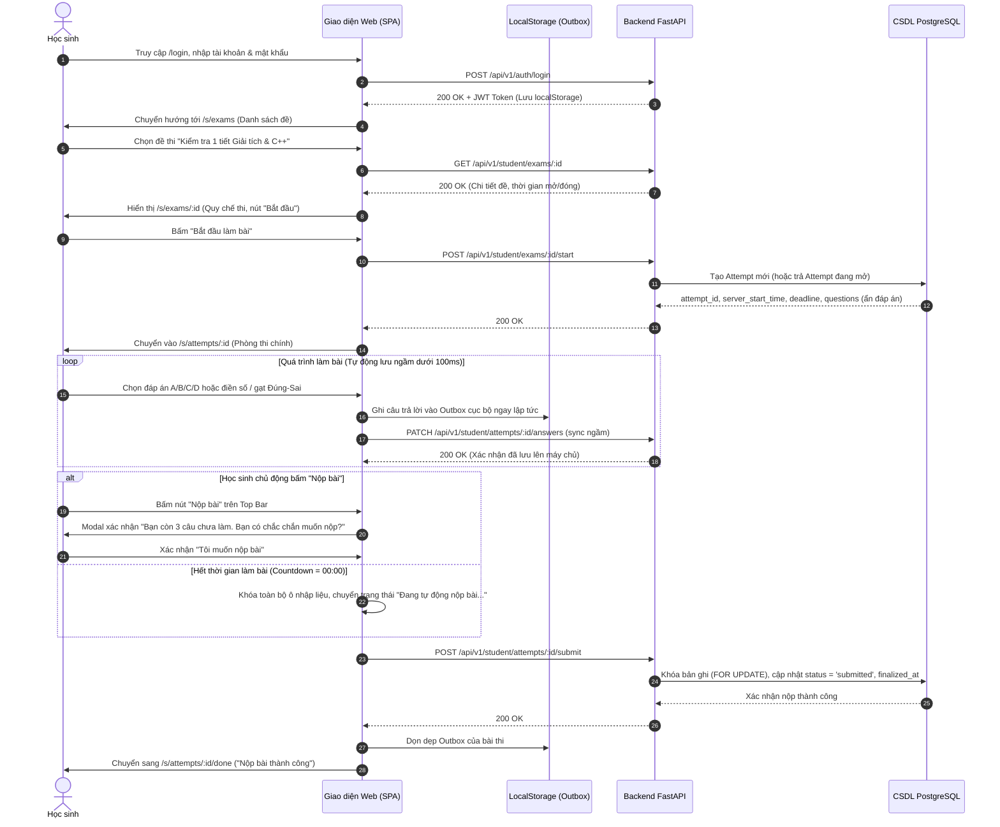
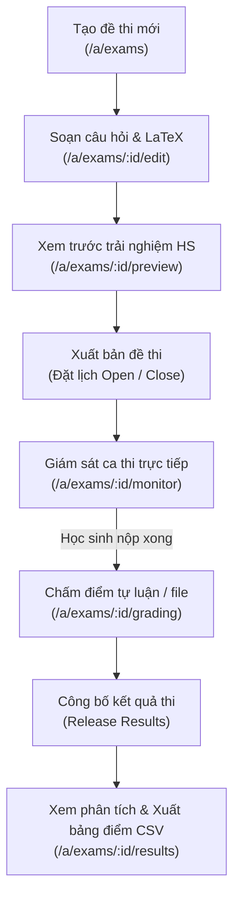
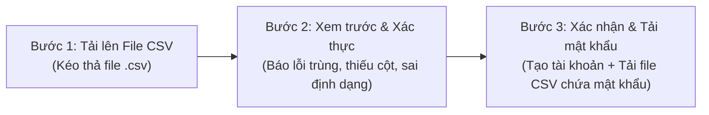

# HÀNH TRÌNH NGƯỜI DÙNG & CÁC NHÁNH GIÁN ĐOẠN (USER JOURNEYS & EDGE FLOWS)

> **Tài liệu tham chiếu:** `ke-hoach-trien-khai-quiz.md` (Bước 1.1) & `docs/ui_ux_rules.md`  
> **Mục tiêu:** Mô tả chi tiết 3 hành trình cốt lõi và các kịch bản xử lý gián đoạn ngoại lệ (mất mạng, hết giờ, mở 2 tab, cộng thêm giờ thi).

---

## 1. HÀNH TRÌNH 1: HỌC SINH THAM GIA BÀI THI (THE ASSESSMENT FLOW)

### 1.1. Luồng chuẩn từ Đăng nhập đến Xem kết quả

---

### 1.2. Các kịch bản gián đoạn & Khắc phục sự cố (Disruption Branches - TC-1.1-04)

#### Nhánh 1: Mất kết nối Internet khi đang làm bài (Offline Tolerance)
1. **Phát hiện:** `window.addEventListener('offline')` hoặc gọi API lưu đáp án thất bại liên tiếp 2 lần.
2. **Trạng thái UI:**
   - Đỉnh màn hình hiện **Offline Alert Banner** màu Amber dịu mắt: `"Mất kết nối mạng. Bài làm của bạn đang được lưu an toàn trong máy tính này. Vui lòng không đóng tab."`
   - Đồng hồ đếm ngược **vẫn tiếp tục đếm chính xác** bằng monotonic timer (`performance.now()`).
   - Học sinh **vẫn tiếp tục làm các câu hỏi khác bình thường**, mọi thao tác ghi lập tức vào `localStorage` (hàng đợi Outbox).
3. **Phục hồi khi có mạng trở lại:**
   - Khi có sự kiện `online`, hệ thống kích hoạt tự động gửi vét toàn bộ hàng đợi Outbox lên API (`syncOutbox()`).
   - Đổi Banner sang màu xanh Emerald: `"Đã kết nối lại. Toàn bộ đáp án đã được đồng bộ lên máy chủ."` (tự ẩn sau 3 giây).

#### Nhánh 2: Hết thời gian thi khi đang gõ đáp số (Timer Expiry Grace Period)
1. **Phát hiện:** Bộ đếm giờ chạm `00:00`.
2. **Xử lý tại Client:**
   - Ngay lập tức vô hiệu hóa bàn phím và chuột trên vùng câu hỏi (`pointer-events-none opacity-80`).
   - Gọi ngay lệnh nộp bài cuối cùng `submitOnce()`.
3. **Xử lý tại Server (Thời gian ân hạn):**
   - Server cấu hình thời gian ân hạn `grace_seconds` (mặc định 5–10 giây) để cho phép gói tin bay qua mạng Internet sau khi đồng hồ client chạm 0.
   - Nếu gói tin đến trong thời gian `deadline + grace`, server chấp nhận và lưu điểm trọn vẹn.
   - Nếu quá hạn hoàn toàn, server trả mã lỗi `409 attempt_closed`, client tự động chuyển sang trang `/s/attempts/:id/done` kèm thông báo: `"Bài thi đã được hệ thống thu bài tự động."`

#### Nhánh 3: Học sinh vô tình mở 2 tab cùng lúc (Concurrent Tab Conflict)
1. **Phát hiện:** Sử dụng `BroadcastChannel` hoặc sự kiện `storage` giữa các tab trình duyệt.
2. **Xử lý UI tại Tab 1:**
   - Tab cũ bị phủ một lớp màn hình mờ kỹ thuật: `"Bài thi đang được mở ở một cửa sổ khác. Để tránh xung đột dữ liệu, cửa sổ này đã tạm dừng."` kèm nút `[ Sử dụng lại cửa sổ này ]`.
   - Đáp án mới nhất luôn được đồng bộ qua máy chủ và Outbox.

#### Nhánh 4: Giáo viên can thiệp cộng thêm giờ thi (Extra Time Adjustment)
1. **Phát hiện:** Khi tab làm bài định kỳ ping `/api/v1/time` hoặc `/status`, server trả về `deadline` mới đã được gia hạn bởi giáo viên.
2. **Xử lý UI:**
   - Đồng hồ nhảy cập nhật lại số phút còn lại.
   - Xuất hiện thông báo Toast nhẹ ở góc dưới: `"Giáo viên đã cộng thêm cho bạn +10 phút làm bài."`

---

## 2. HÀNH TRÌNH 2: GIÁO VIÊN SOẠN ĐỀ, GIÁM SÁT & CHẤM THI

### Các mốc thao tác chính của Giáo viên:
1. **Soạn thảo đề (5 dạng câu):**
   - Trắc nghiệm 4 lựa chọn (MCQ).
   - Trắc nghiệm Đúng/Sai 4 mệnh đề (a, b, c, d).
   - Trả lời ngắn điền số.
   - Câu hỏi đính kèm khối mã nguồn (C++, Python).
   - Tự luận tải tệp ảnh/PDF.
2. **Giám sát trực tiếp (Live Monitor):**
   - Bảng Bento Grid hiển thị từng ô học sinh kèm màu trạng thái: Xanh lá (Đang làm), Vàng (Mất kết nối tạm thời), Xám (Chưa vào), Xanh dương (Đã nộp bài).
   - Giáo viên có các nút thao tác khẩn cấp: `[ Cộng 5 phút ]`, `[ Cho phép làm lại ]`, `[ Thu bài cưỡng chế ]`.

---

## 3. HÀNH TRÌNH 3: NHẬP DANH SÁCH HỌC SINH TỪ CSV (3-STEP WIZARD)

### Chi tiết các bước đảm bảo an toàn bảo mật:
1. **Bước 1 (Upload):** Kéo thả file CSV danh sách học sinh. Cung cấp nút tải tệp mẫu `mau_danh_sach_hoc_sinh.csv`.
2. **Bước 2 (Validation):** Phân tích dữ liệu ngay tại Client và Backend:
   - Kiểm tra mã định danh học sinh trùng lặp.
   - Kiểm tra họ tên tiếng Việt có dấu hợp lệ.
   - Báo lỗi cụ thể từng dòng (ví dụ: *Dòng 14: Mã học sinh 'HS002' đã tồn tại trong lớp 12A2*).
3. **Bước 3 (Confirmation & One-time Credential Sheet):**
   - Tuyệt đối không sinh mật khẩu mặc định như `123456`.
   - Hệ thống sinh mật khẩu ngẫu nhiên an toàn cho từng học sinh mới.
   - Bắt buộc giáo viên bấm nút `[ Tải xuống bảng mật khẩu tài khoản (CSV) ]` trước khi đóng hộp thoại.
   - Cảnh báo: *"Mật khẩu chỉ hiển thị một lần duy nhất tại đây. Hãy lưu trữ cẩn thận và phát cho từng học sinh."*
