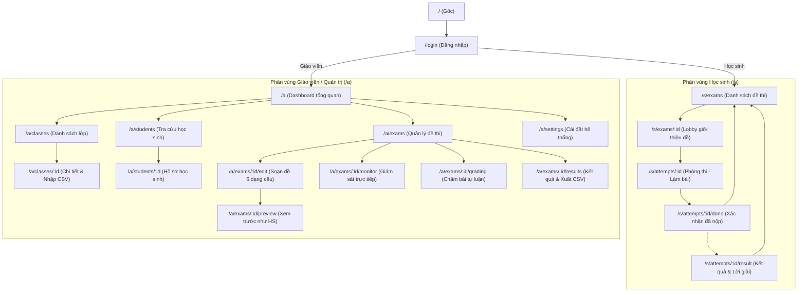

# SƠ ĐỒ ĐỊNH TUYẾN & DANH MỤC TRANG (SITEMAP & ROUTING ARCHITECTURE)

> **Tài liệu tham chiếu:** `ke-hoach-trien-khai-quiz.md` (Bước 1.1) & `docs/ui_ux_rules.md`  
> **Nguyên tắc thẩm mỹ:** "Emerald Precision" — Tối ưu hóa công thái học, không gây mỏi mắt trong bài thi 90 phút, hỗ trợ chuyển đổi Light/Dark mode mượt mà.

---

## 1. TỔNG QUAN KIẾN TRÚC PHÂN QUYỀN ĐỊNH TUYẾN

Hệ thống được tổ chức thành 3 phân vùng định tuyến chính được bảo vệ bởi middleware `RequireAuth(role)`:

1. **Phân vùng Công khai (Public Zone):** Dành cho xác thực người dùng.
2. **Phân vùng Học sinh (Student Zone - Tiền tố `/s`):** Tập trung tối đa vào trải nghiệm thi cử mượt mà, không xao nhãng.
3. **Phân vùng Quản trị / Giáo viên (Admin Zone - Tiền tố `/a`):** Quản lý đề thi, lớp học, học sinh, chấm bài và giám sát ca thi thời gian thực.

---

## 2. BẢNG CHI TIẾT 14 ROUTE CHÍNH CỦA HỆ THỐNG

| Mã màn hình | Đường dẫn Route | Quyền truy cập | Tiêu đề trang (Page Title) | Bố cục Layout | Mục đích chính | Đường dẫn thoát / Quay lại |
| :--- | :--- | :---: | :--- | :--- | :--- | :--- |
| **SC-01** | `/login` | Public | Đăng nhập Hệ thống | Minimal Centered Card | Xác thực tài khoản bằng Username + Password | Tự động chuyển `/s/exams` hoặc `/a` |
| **SC-02** | `/s/exams` | Student | Đề thi của tôi | Student Standard App Shell | Liệt kê các bài thi đang mở, sắp diễn ra và đã hoàn thành | Đăng xuất |
| **SC-03** | `/s/exams/:id` | Student | Hướng dẫn & Vào thi | Focused Container (max-w 800px) | Xem quy chế thi, số lượng câu, thời gian; nút bấm "Bắt đầu làm bài" | Về `/s/exams` |
| **SC-04** | `/s/attempts/:id` | Student | Phòng thi: Làm bài | Assessment Workspace (2 cột: Focus Zone + Bento Palette) | Màn hình làm bài thi chính (1 cột đề, đồng hồ countdown, bàn phím điều hướng) | Nộp bài $\to$ `/s/attempts/:id/done` |
| **SC-05** | `/s/attempts/:id/done` | Student | Nộp bài thành công | Minimal Result Confirmation | Xác nhận hệ thống đã lưu bài thi; hiển thị thời gian nộp; xem điểm nếu đề mở ngay | Về `/s/exams` hoặc sang `/result` |
| **SC-06** | `/s/attempts/:id/result`| Student | Kết quả & Lời giải | Review Container (1 cột kèm Accordion) | Xem chi tiết bài làm, điểm số, lời giải $\LaTeX$ và code giải thích từng câu | Về `/s/exams` |
| **SC-07** | `/a` | Admin/Teacher| Bảng điều khiển | Admin Sidebar Shell | Thống kê số lượng học sinh, đề thi, ca thi đang mở, lối tắt tác vụ | Đăng xuất |
| **SC-08** | `/a/classes` | Admin/Teacher| Quản lý Lớp học | Admin Table View | Danh sách các lớp học, sĩ số, tìm kiếm, nút tạo lớp mới | Về `/a` |
| **SC-09** | `/a/classes/:id` | Admin/Teacher| Chi tiết Lớp học & CSV | Admin Tabbed View | Danh sách học sinh trong lớp, lịch sử thi, modal wizard nhập CSV 3 bước | Về `/a/classes` |
| **SC-10** | `/a/students` | Admin/Teacher| Danh sách Học sinh | Admin Table View | Tìm kiếm, lọc học sinh theo lớp, xem trạng thái tài khoản | Về `/a` |
| **SC-11** | `/a/exams` | Admin/Teacher| Quản lý Đề thi | Admin Grid/Table View | Danh sách đề thi (Bản nháp, Đã xuất bản, Đang thi, Đã đóng), nút tạo đề | Về `/a` |
| **SC-12** | `/a/exams/:id/edit`| Admin/Teacher| Soạn thảo Đề thi | Fullscreen Split Editor | Soạn 5 dạng câu hỏi, xem trước KaTeX real-time, upload ảnh asset | Về `/a/exams` |
| **SC-13** | `/a/exams/:id/preview`| Admin/Teacher| Xem trước Đề thi | Assessment Workspace (Simulated) | Giáo viên trải nghiệm làm thử bài thi giống hệt học sinh (không ghi điểm) | Về `/a/exams/:id/edit` |
| **SC-14** | `/a/exams/:id/monitor`| Admin/Teacher| Giám sát Trực tiếp | Realtime Bento Matrix | Giám sát trạng thái 40–50 học sinh (online, offline, số câu đã lưu, gian lận) | Về `/a/exams` |
| **SC-15** | `/a/exams/:id/grading`| Admin/Teacher| Chấm bài Tự luận | Dual Pane Grading Workspace | Chấm điểm câu trả lời ngắn / tự luận nộp file, nhập nhận xét | Về `/a/exams` |
| **SC-16** | `/a/exams/:id/results`| Admin/Teacher| Báo cáo & Xuất điểm | Analytics Dashboard | Biểu đồ phổ điểm, tỷ lệ làm đúng từng câu, nút xuất bảng điểm CSV/Excel | Về `/a/exams` |
| **SC-17** | `/a/settings` | Admin/Teacher| Cài đặt Hệ thống | Admin Form Layout | Cấu hình lưu trữ dữ liệu, đổi mật khẩu quản trị, phiên làm việc | Về `/a` |

---

## 3. NGUYÊN TẮC BẢO ĐẢM KHÔNG CÓ "MÀN HÌNH CỤT" (DEAD-END PREVENTION)

Mọi màn hình trong hệ thống bắt buộc phải có ít nhất 2 hướng điều hướng thoát hiểm:
1. **Thanh điều hướng toàn cục (Header / Sidebar):** Luôn hiển thị logo có thể click để quay về trang chủ vai trò tương ứng (`/s/exams` hoặc `/a`), kèm breadcrumbs rõ ràng (ví dụ: `Lớp 12A1 > Danh sách học sinh > Nhập CSV`).
2. **Nút hành động thứ cấp (Secondary Action / Cancel):** Mọi màn hình chi tiết, biểu mẫu, dialog nhập liệu đều có nút `[ Quay lại ]` hoặc `[ Hủy ]` cạnh nút hành động chính.
3. **Màn hình Nộp bài (`/s/attempts/:id/done`):** Cung cấp 2 lựa chọn rõ ràng:
   - `[ Quay lại danh sách đề thi ]` $\to$ Trỏ về `/s/exams`.
   - `[ Xem kết quả bài làm ]` $\to$ Trỏ về `/s/attempts/:id/result` (hoặc hiển thị thông báo "Điểm sẽ được công bố vào lúc [Thời gian]").
