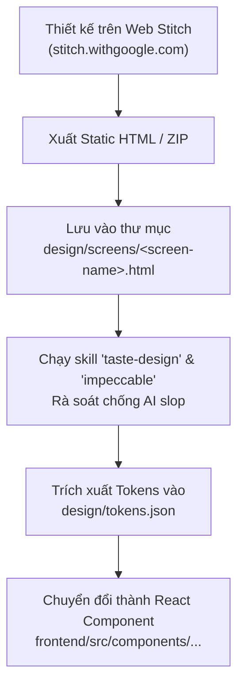

# HƯỚNG DẪN KẾT NỐI STITCH MCP & QUY TRÌNH DỰ PHÒNG THỦ CÔNG (STEP 0.3)

> **Tài liệu tham chiếu:** `ke-hoach-trien-khai-quiz.md` (Bước 0.3) & `quiz-toan-tin-spec.md` (Mục 11, 14)  
> **Mục tiêu:** Thiết lập kết nối Stitch MCP, quản lý vòng đời xác thực ADC và đảm bảo quy trình xuất màn hình dự phòng không bị gián đoạn.

---

## 1. TỔNG QUAN HỆ THỐNG SKILLS & STITCH MCP ĐÃ THIẾT LẬP

Dự án đã tích hợp đầy đủ 8 skills thiết kế chuyên sâu tại `.agents/skills/`:

| Tên Skill | Nguồn | Mục đích sử dụng chính |
| :--- | :--- | :--- |
| `design-md` | Google Labs | Trích xuất và tổng hợp Design System ngữ nghĩa vào file `DESIGN.md`. |
| `enhance-prompt` | Google Labs | Tối ưu hóa prompt UI, bổ sung thuật ngữ chuyên nghiệp cho Stitch. |
| `stitch-loop` | Google Labs | Vòng lặp xây dựng UI tự động theo cơ chế baton-passing. |
| `stitch::generate-design` | Google Labs | Sinh màn hình mới, biến thể màn hình từ prompt qua Stitch API. |
| `stitch::react-components` | Google Labs | Chuyển đổi mã thiết kế Stitch thành React Components chuẩn Vite/Tailwind. |
| `taste-design` | Google Labs | Chuẩn hóa UI cao cấp, chống "AI slop", typographic scale nghiêm ngặt. |
| `frontend-design` | Anthropic | Định hướng thẩm mỹ, phân cấp trực quan, tránh giao diện rập khuôn. |
| `impeccable` | pbakaus | Tinh chỉnh chi tiết: vi chuyển động, độ tương phản WCAG, responsive. |

---

## 2. QUẢN LÝ XÁC THỰC GOOGLE CLOUD ADC (TC-0.3-04)

Stitch MCP sử dụng cơ chế xác thực Google Cloud Application Default Credentials (ADC). Khi token ADC hết hạn hoặc chưa khởi tạo:

### 2.1. Đăng nhập và cấp mới ADC Token
Mở terminal và thực thi:
```bash
gcloud auth login
gcloud auth application-default login
```
Sau khi hoàn tất đăng nhập trên trình duyệt, tệp thông tin xác thực sẽ được tự động lưu tại `~/.config/gcloud/application_default_credentials.json`.

### 2.2. Kích hoạt API Stitch trên Google Cloud Project
```bash
gcloud beta services mcp enable stitch.googleapis.com
```

### 2.3. Khắc phục sự cố Token hết hạn (Token Expired)
Nếu Antigravity hoặc Stitch MCP trả về lỗi `UNAUTHENTICATED`, `401 Unauthorized`, hoặc `Re-authentication required`:
1. Chạy lệnh làm mới:
   ```bash
   gcloud auth application-default login
   ```
2. Khởi động lại phiên làm việc của agent để nạp lại token mới.

---

## 3. QUY TRÌNH DỰ PHÒNG XUẤT THIẾT KẾ THỦ CÔNG (TC-0.3-05)

Trong trường hợp Stitch MCP gặp sự cố mạng, hạn ngạch API (quota) hoặc dịch vụ bảo trì, quy trình thiết kế UI được chuyển sang chế độ **Dự phòng thủ công (Manual Fallback)** theo các bước chuẩn hóa sau:



### Chi tiết các bước thực hiện:

1. **Thiết kế trực tiếp trên giao diện Web:**
   - Truy cập: [https://stitch.withgoogle.com](https://stitch.withgoogle.com)
   - Sử dụng prompt đã được làm giàu qua skill `enhance-prompt` hoặc định hướng thẩm mỹ từ `frontend-design`.
2. **Lưu trữ mã nguồn giao diện:**
   - Sao chép toàn bộ mã HTML/Tailwind hoặc tải file HTML xuất ra.
   - Đặt tên file theo mã màn hình chuẩn (ví dụ: `SC-01-login.html`, `SC-05-taking-exam.html`).
   - Lưu trữ tại: [`design/screens/`](file:///home/leduchuy/coding-space/projects/quiz-app/design/screens/).
3. **Chuẩn hóa Design Tokens & Chống AI Slop:**
   - Áp dụng các quy tắc trong `taste-design` và `DESIGN.md` để đảm bảo:
     - Phông chữ tiếng Việt hiển thị sắc nét (`Be Vietnam Pro`).
     - Tỷ lệ màu đạt chuẩn tương phản WCAG AA.
     - Trạng thái đồng hồ làm bài có chỉ báo rõ ràng (bình thường / cảnh báo / nguy cấp).
4. **Chuyển thành React Components:**
   - Sử dụng `stitch-react-components` hoặc viết component trực tiếp trong `frontend/src/` bám sát cây thư mục của dự án.
